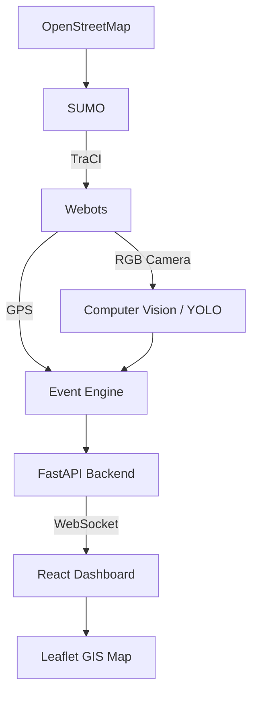

# SIH26124 System Architecture (Webots MVP)

## Core Technologies
- **Simulation:** Webots (3D Graphics, Cameras, Physics) + SUMO (Traffic Intelligence via TraCI)
- **Computer Vision:** YOLOv11 (`ultralytics`)
- **Backend:** FastAPI, SQLite, WebSockets
- **Frontend:** React, Vite, Tailwind CSS, Leaflet

## Data Flow

## Simulation Architecture (Low VRAM Optimized)
- Webots handles only the immediate vicinity of the bus.
- SUMO handles the global traffic simulation.
- `SIMULATION_MODE=mock` is the default for rapid UI/API development.
- `SIMULATION_MODE=webots` enables the heavy 3D simulation pipeline.
